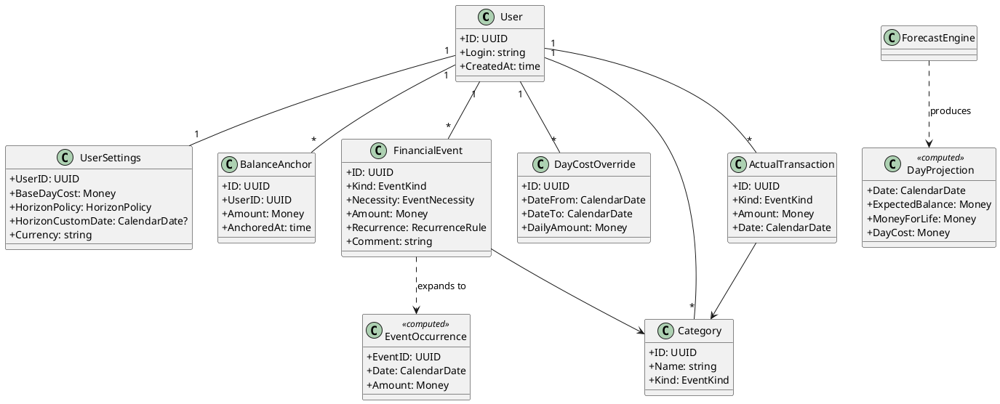

# 2. Domain Model

## 2.1 Глоссарий

| Термин | Определение |
|--------|-------------|
| **Баланс** | Количество денег «сейчас». Вычисляется из последнего якоря минус всё, что произошло после него. |
| **Якорь баланса (Balance Anchor)** | Точка отсчёта: сумма + момент времени, который пользователь зафиксировал вручную. |
| **Деньги на жизнь (Money for Life, MFL)** | Баланс минус все обязательные будущие расходы минус стоимость каждого дня до горизонта. |
| **Базовая стоимость дня** | Фиксированная сумма, которую пользователь задаёт вручную (например, 1400 ₽). Не меняется автоматически. |
| **Оверрайд стоимости дня** | Временное изменение стоимости дня на диапазон дат (например, 300 ₽/день на неделю у родителей). |
| **Financial Event** | Плановое событие: доход или расход с датой, суммой, категорией, обязательностью. |
| **Actual Transaction** | Фактическая операция из банка/ручного ввода. Участвует только в статистике, не в прогнозе. |
| **Горизонт (Horizon)** | Дата, до которой считаются «будущие» обязательства для MFL. |
| **Required / Optional** | Обязательные расходы участвуют в MFL; необязательные — только в прогнозе баланса. |

## 2.2 Value Objects

### Money

```go
// domain/money.go
type Money struct {
    Amount   int64  // копейки
    Currency string // "RUB" — MVP одна валюта
}
```

**Почему int64 в копейках:** избегаем ошибок float; стандарт для финансовых систем.

**Альтернатива:** `decimal.Decimal` — точнее для мультивалютности, но избыточно для MVP с RUB.

### Date (CalendarDate)

```go
// domain/date.go
type CalendarDate struct {
    Year  int
    Month int
    Day   int
}
```

**Почему отдельный тип, а не `time.Time`:** финансовые даты — календарные, без timezone-артефактов.

### RecurrenceRule

```go
// domain/recurrence.go
type RecurrenceType string

const (
    RecurrenceNone          RecurrenceType = "NONE"
    RecurrenceMonthlyOnDay  RecurrenceType = "MONTHLY_ON_DAY"
    RecurrenceEveryNDays    RecurrenceType = "EVERY_N_DAYS"
    // RecurrenceCron       RecurrenceType = "CRON"  // v2
)

type RecurrenceRule struct {
    Type         RecurrenceType
    StartDate    CalendarDate
    DayOfMonth   *int           // для MONTHLY_ON_DAY (1-31)
    IntervalDays *int           // для EVERY_N_DAYS
    Until        *CalendarDate  // nil = бесконечно
    // CronExpr   *string        // v2
}
```

**Почему одна таблица/структура, а не отдельная таблица правил:** для MVP два типа повторений достаточно; разовое событие = `Type: NONE`.

**Альтернатива:** отдельная таблица `recurrence_rules` + FK — чище для cron v2, но лишний JOIN на каждый запрос в MVP.

**Компромисс:** поля `day_of_month`, `interval_days`, `cron_expr` nullable в одной таблице; добавление CRON = новый enum + валидация.

### HorizonPolicy

```go
type HorizonPolicy string

const (
    HorizonEndOfMonth HorizonPolicy = "END_OF_MONTH"
    HorizonNextIncome HorizonPolicy = "NEXT_INCOME"
    HorizonCustomDate HorizonPolicy = "CUSTOM_DATE"
)
```

**Почему три политики:** покрывают 90% кейсов; дефолт `END_OF_MONTH`, большинство пользователей переключат на `NEXT_INCOME`.

### EventKind, EventNecessity

```go
type EventKind string
const (
    EventKindIncome  EventKind = "INCOME"
    EventKindExpense EventKind = "EXPENSE"
)

type EventNecessity string
const (
    NecessityRequired EventNecessity = "REQUIRED"
    NecessityOptional EventNecessity = "OPTIONAL"
)
```

## 2.3 Entities

### User

```go
type User struct {
    ID        uuid.UUID
    Login     string
    CreatedAt time.Time
}
```

### UserSettings

```go
type UserSettings struct {
    UserID            uuid.UUID
    BaseDayCost       Money
    HorizonPolicy     HorizonPolicy
    HorizonCustomDate *CalendarDate // для CUSTOM_DATE
    Currency          string
    UpdatedAt         time.Time
}
```

### BalanceAnchor

```go
type BalanceAnchor struct {
    ID         uuid.UUID
    UserID     uuid.UUID
    Amount     Money
    AnchoredAt time.Time // момент фиксации (обычно «сейчас»)
    CreatedAt  time.Time
}
```

**Почему история якорей, а не одно поле:** аудит, возможность пересчитать; актуален последний по `anchored_at`.

**Альтернатива:** одно поле `current_balance` в settings — проще, но теряем историю и усложняем отладку расхождений.

### FinancialEvent

```go
type FinancialEvent struct {
    ID          uuid.UUID
    UserID      uuid.UUID
    Kind        EventKind
    Necessity   EventNecessity  // только для EXPENSE; для INCOME игнорируется
    Amount      Money
    CategoryID  *uuid.UUID
    Comment     string
    Recurrence  RecurrenceRule
    CreatedAt   time.Time
    UpdatedAt   time.Time
}
```

**Инварианты:**
- `Amount > 0`
- `Necessity` meaningful только для `EXPENSE`
- `Recurrence.Type == NONE` → дата события = `Recurrence.StartDate`
- `MONTHLY_ON_DAY` → `DayOfMonth` обязателен (1-31; 31 → последний день месяца)
- `EVERY_N_DAYS` → `IntervalDays >= 1`

### EventOccurrence (вычисляемая, не хранится)

```go
type EventOccurrence struct {
    EventID   uuid.UUID
    Date      CalendarDate
    Kind      EventKind
    Necessity EventNecessity
    Amount    Money
    CategoryID *uuid.UUID
    Comment   string
    IsOverridden bool // v2: из event_occurrence_overrides
}
```

### EventOccurrenceOverride (зарезервировано v2)

```go
type EventOccurrenceOverride struct {
    ID        uuid.UUID
    EventID   uuid.UUID
    Date      CalendarDate
    Amount    *Money          // nil = skip occurrence
    Comment   *string
    CreatedAt time.Time
}
```

**Почему зарезервировано:** пользователь выбрал «редактировать только серию» в MVP, но таблица нужна для будущего «изменить одно вхождение».

### DayCostOverride

```go
type DayCostOverride struct {
    ID          uuid.UUID
    UserID      uuid.UUID
    DateFrom    CalendarDate
    DateTo      CalendarDate  // inclusive
    DailyAmount Money
    Comment     string
    CreatedAt   time.Time
}
```

**Инварианты:**
- `DateFrom <= DateTo`
- `DailyAmount >= 0`
- При пересечении диапазонов: побеждает override с более поздним `created_at`

**Почему диапазон, а не список дат:** типичный кейс «неделя у родителей» — один объект; список дат усложнил бы UI без выигрыша.

**Альтернатива:** override как «событие» с amount — семантически неверно (это не расход, а изменение базовой стоимости).

### Category

```go
type Category struct {
    ID        uuid.UUID
    UserID    uuid.UUID
    Name      string
    Kind      EventKind // INCOME или EXPENSE
    IsDefault bool      // системные дефолты при регистрации
    CreatedAt time.Time
}
```

**Почему плоский справочник:** MVP не требует иерархии; flat list проще в UI и SQL.

**Альтернатива:** иерархия (parent_id) — отложена; поле можно добавить без breaking changes.

### ActualTransaction

```go
type ActualTransaction struct {
    ID         uuid.UUID
    UserID     uuid.UUID
    Kind       EventKind
    Amount     Money
    CategoryID *uuid.UUID
    Date       CalendarDate
    Comment    string
    EventID    *uuid.UUID // опциональная связь с плановым событием
    CreatedAt  time.Time
}
```

**Почему отдельная сущность:** план vs факт — разные жизненные циклы; CSV-импорт пишет сюда, не ломая прогноз.

**Компромисс:** пользователь может видеть расхождение план/факт только когда добавим аналитику; в MVP факт не влияет на баланс.

## 2.4 Aggregates (логические границы)

| Aggregate | Root | Содержимое |
|-----------|------|------------|
| UserProfile | User | UserSettings |
| Balance | BalanceAnchor | (история якорей) |
| EventCatalog | FinancialEvent | EventOccurrenceOverride (v2) |
| DayCost | UserSettings.BaseDayCost | DayCostOverride[] |
| Categories | Category | — |
| Actuals | ActualTransaction | — |

MVP не использует DDD-репозитории per aggregate; границы нужны для понимания транзакционности.

## 2.5 Вычисляемые модели (не персистятся)

### DayProjection

```go
type DayProjection struct {
    Date            CalendarDate
    ExpectedBalance Money
    DayCost         Money
    MoneyForLife    Money
    Events          []EventOccurrence
    RequiredTotal   Money
    OptionalTotal   Money
    IncomeTotal     Money
}
```

### ForecastSummary

```go
type ForecastSummary struct {
    CurrentBalance     Money
    MoneyForLife       Money
    HorizonDate        CalendarDate
    HorizonPolicy      HorizonPolicy
    RequiredRemaining  Money
    DayCostRemaining   Money
    OptionalRemaining  Money  // informational
    DaysUntilHorizon   int
}
```

### BalanceState

```go
type BalanceState struct {
    Anchor           BalanceAnchor
    ComputedBalance  Money  // якорь − прошедшее
    AsOf             time.Time
}
```

## 2.6 Алгоритм ForecastEngine (чистая функция domain)

Расположение: `backend/internal/domain/forecast/engine.go`

### Вход

```go
type ForecastInput struct {
    Anchor       BalanceAnchor
    Settings     UserSettings
    Events       []FinancialEvent
    Overrides    []DayCostOverride
    OccOverrides []EventOccurrenceOverride // v2, MVP: пустой
    RangeFrom    CalendarDate
    RangeTo      CalendarDate
    AsOf         time.Time
}
```

### Выход

```go
type ForecastOutput struct {
    Days      []DayProjection
    Summary   ForecastSummary
}
```

### Шаг 1: Развернуть события в вхождения

```
ExpandEvents(events, rangeFrom, rangeTo) → map[CalendarDate][]EventOccurrence
```

- `NONE`: одно вхождение на `StartDate`
- `MONTHLY_ON_DAY`: каждый месяц в `DayOfMonth` (31 → min(31, lastDayOfMonth))
- `EVERY_N_DAYS`: `StartDate`, `StartDate+N`, ... пока <= `Until` или `RangeTo`
- Применить `OccOverrides` (v2): skip или заменить amount

**Почему на лету, а не materialized occurrences:** экономия storage; для MVP объём данных мал; cron v2 не потребует backfill.

**Альтернатива:** materialized table `event_occurrences` — быстрее read, но нужен job пересчёта при изменении серии.

### Шаг 2: Функция стоимости дня

```
DayCost(date, settings, overrides) → Money
```

1. Найти все overrides, где `dateFrom <= date <= dateTo`
2. Если есть — взять с max(`created_at`)
3. Иначе — `settings.BaseDayCost`

### Шаг 3: Вычислить горизонт

```
ResolveHorizon(settings, events, asOfDate) → CalendarDate
```

| Policy | Алгоритм |
|--------|----------|
| `END_OF_MONTH` | последний день текущего месяца |
| `NEXT_INCOME` | ближайшее вхождение события `Kind=INCOME`; дата дохода является исключительной границей (сам доход и стоимость этого дня не входят в текущий MFL); fallback → END_OF_MONTH |
| `CUSTOM_DATE` | `settings.HorizonCustomDate` |

Для `END_OF_MONTH` и `CUSTOM_DATE` день горизонта включается. Текущий день всегда
включается в резерв стоимости дня. Все календарные границы MVP вычисляются в
`Europe/Moscow` (UTC+3); timestamps сохраняются и передаются в UTC.

### Шаг 4: Проход по дням (от якоря до RangeTo)

```
balance = anchor.Amount
currentDate = date(anchor.AnchoredAt)

for each day D from currentDate to RangeTo:
    if D > date(anchor.AnchoredAt):
        cost = DayCost(D)
        balance -= cost
        balance -= sum(expenses on D)
        balance += sum(incomes on D)

    store ExpectedBalance(D) = balance
```

**День якоря:** сумма якоря уже включает все события и стоимость этого календарного
дня. Автоматическое списание начинается со следующего дня — иначе возникает двойной
учёт операций без времени.

**Прошедшие дни:** стоимость дня и события списываются/начисляются автоматически (решение Q&A).

**Почему аддитивная стоимость дня:** аренда 30 000 + базовые 1400 = реалистичнее (аренда не заменяет еду).

### Шаг 5: Money for Life на каждый день D

```
MFL(D) = ExpectedBalance(D)
       - sum(REQUIRED expenses from D+1 to Horizon)
       - sum(DayCost(d) for d in D+1..Horizon)
```

Optional expenses **не** вычитаются из MFL (только informational в прогнозе).

**Почему MFL включает day cost:** ключевая идея продукта — «сколько дней я ещё проживу» без mental math.

### Шаг 6: ForecastSummary (на AsOf)

```
Summary.CurrentBalance = ExpectedBalance(today)
Summary.MoneyForLife   = MFL(today)
Summary.RequiredRemaining = sum(REQUIRED expenses today+1..Horizon)
Summary.DayCostRemaining  = sum(DayCost today+1..Horizon)
```

### Сложность

O(days in range + occurrences in range). Для календаря на 3 месяца (~90 дней) + ~100 событий — пренебрежимо.

### Пример

```
Якорь: 10 000 ₽, 7 число
Сегодня: 12 число
BaseDayCost: 1 400 ₽
Событий нет

ComputedBalance = 10 000 - 5 × 1 400 = 3 000 ₽
Horizon: 17 число (NEXT_INCOME) — допустим, доход 17-го
DayCostRemaining = 5 × 1 400 = 7 000 ₽
MFL = 3 000 - 7 000 = -4 000 ₽  → UI показывает «не хватает»
```

## 2.7 Диаграмма Domain Model (PlantUML)



## 2.8 Инварианты системы (сводка)

1. Суммы всегда > 0 в событиях и транзакциях
2. Баланс выводится из якоря, не хранится как mutable state
3. ActualTransaction не участвует в ForecastEngine
4. MFL учитывает только REQUIRED расходы + day cost до горizonta
5. Day cost аддитивен к событиям дня
6. Override day cost имеет приоритет над base day cost
7. Прошедшие плановые события считаются исполненными

## 2.9 Расширяемость Domain Model

| Изменение | Impact |
|-----------|--------|
| Cron recurrence | +enum, +поле, +логика в ExpandEvents |
| Occurrence edit | Заполнение EventOccurrenceOverride, логика уже заложена |
| Multi-currency | Money.Currency + conversion service (новый domain service) |
| Plan vs Fact analytics | Read-only queries по FinancialEvent + ActualTransaction |
| Notifications | Domain events (optional) или worker polling ForecastSummary |
