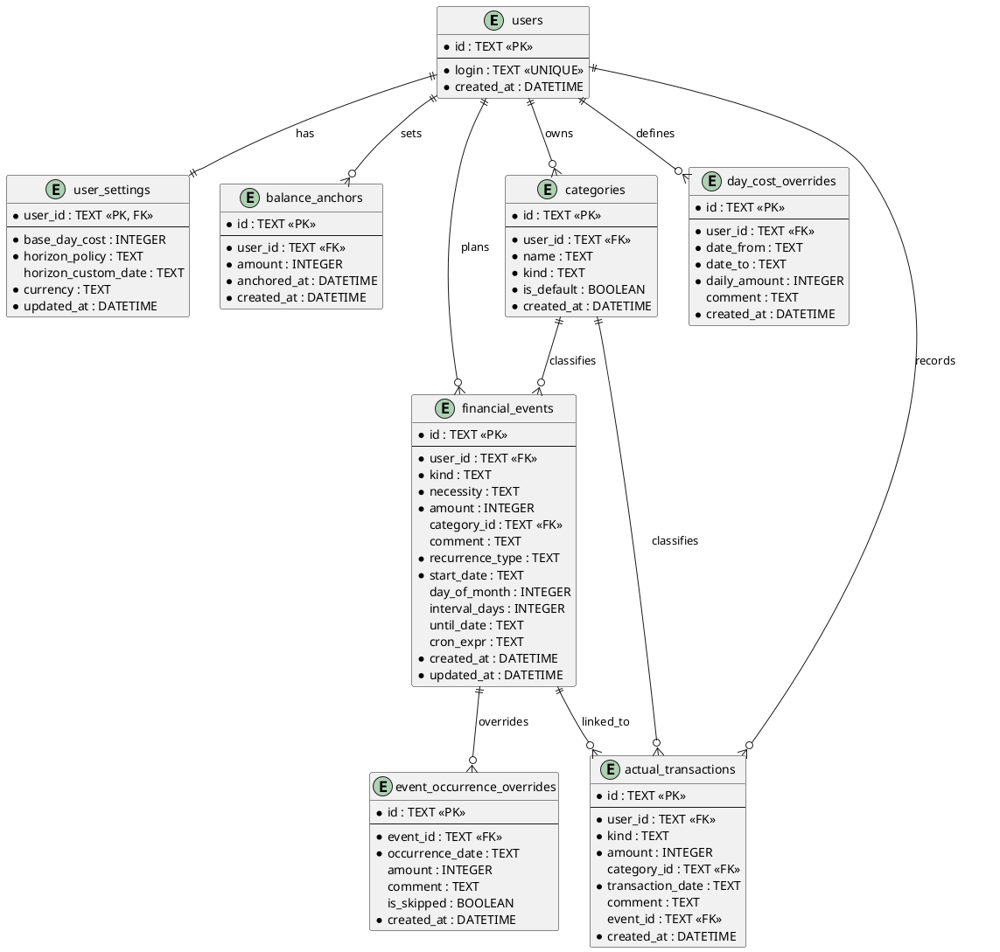

# 3. База данных

## 3.1 ERD (PlantUML)



## 3.2 DDL SQLite (MVP)

```sql
-- migrations/001_initial.sql

PRAGMA foreign_keys = ON;

CREATE TABLE users (
    id          TEXT PRIMARY KEY,  -- UUID v4
    login       TEXT NOT NULL UNIQUE COLLATE NOCASE,
    created_at  DATETIME NOT NULL DEFAULT (datetime('now'))
);

CREATE TABLE user_settings (
    user_id              TEXT PRIMARY KEY REFERENCES users(id) ON DELETE CASCADE,
    base_day_cost        INTEGER NOT NULL DEFAULT 0,  -- kopecks
    horizon_policy       TEXT NOT NULL DEFAULT 'END_OF_MONTH'
                         CHECK (horizon_policy IN ('END_OF_MONTH', 'NEXT_INCOME', 'CUSTOM_DATE')),
    horizon_custom_date  TEXT,  -- YYYY-MM-DD
    currency             TEXT NOT NULL DEFAULT 'RUB',
    updated_at           DATETIME NOT NULL DEFAULT (datetime('now'))
);

CREATE TABLE balance_anchors (
    id          TEXT PRIMARY KEY,
    user_id     TEXT NOT NULL REFERENCES users(id) ON DELETE CASCADE,
    amount      INTEGER NOT NULL,
    anchored_at DATETIME NOT NULL,
    created_at  DATETIME NOT NULL DEFAULT (datetime('now'))
);

CREATE INDEX idx_balance_anchors_user_anchored
    ON balance_anchors(user_id, anchored_at DESC);

CREATE TABLE categories (
    id          TEXT PRIMARY KEY,
    user_id     TEXT NOT NULL REFERENCES users(id) ON DELETE CASCADE,
    name        TEXT NOT NULL,
    kind        TEXT NOT NULL CHECK (kind IN ('INCOME', 'EXPENSE')),
    is_default  INTEGER NOT NULL DEFAULT 0,
    created_at  DATETIME NOT NULL DEFAULT (datetime('now')),
    UNIQUE(user_id, name, kind)
);

CREATE TABLE financial_events (
    id               TEXT PRIMARY KEY,
    user_id          TEXT NOT NULL REFERENCES users(id) ON DELETE CASCADE,
    kind             TEXT NOT NULL CHECK (kind IN ('INCOME', 'EXPENSE')),
    necessity        TEXT NOT NULL DEFAULT 'REQUIRED'
                     CHECK (necessity IN ('REQUIRED', 'OPTIONAL')),
    amount           INTEGER NOT NULL CHECK (amount > 0),
    category_id      TEXT REFERENCES categories(id) ON DELETE SET NULL,
    comment          TEXT NOT NULL DEFAULT '',
    recurrence_type  TEXT NOT NULL DEFAULT 'NONE'
                     CHECK (recurrence_type IN ('NONE', 'MONTHLY_ON_DAY', 'EVERY_N_DAYS')),
    start_date       TEXT NOT NULL,  -- YYYY-MM-DD
    day_of_month     INTEGER CHECK (day_of_month BETWEEN 1 AND 31),
    interval_days    INTEGER CHECK (interval_days >= 1),
    until_date       TEXT,
    cron_expr        TEXT,  -- reserved v2
    created_at       DATETIME NOT NULL DEFAULT (datetime('now')),
    updated_at       DATETIME NOT NULL DEFAULT (datetime('now'))
);

CREATE INDEX idx_financial_events_user ON financial_events(user_id);

CREATE TABLE event_occurrence_overrides (
    id               TEXT PRIMARY KEY,
    event_id         TEXT NOT NULL REFERENCES financial_events(id) ON DELETE CASCADE,
    occurrence_date  TEXT NOT NULL,
    amount           INTEGER,  -- NULL + is_skipped=1 → skip
    comment          TEXT,
    is_skipped       INTEGER NOT NULL DEFAULT 0,
    created_at       DATETIME NOT NULL DEFAULT (datetime('now')),
    UNIQUE(event_id, occurrence_date)
);

CREATE TABLE day_cost_overrides (
    id            TEXT PRIMARY KEY,
    user_id       TEXT NOT NULL REFERENCES users(id) ON DELETE CASCADE,
    date_from     TEXT NOT NULL,
    date_to       TEXT NOT NULL,
    daily_amount  INTEGER NOT NULL CHECK (daily_amount >= 0),
    comment       TEXT NOT NULL DEFAULT '',
    created_at    DATETIME NOT NULL DEFAULT (datetime('now')),
    CHECK (date_from <= date_to)
);

CREATE INDEX idx_day_cost_overrides_user_dates
    ON day_cost_overrides(user_id, date_from, date_to);

CREATE TABLE actual_transactions (
    id               TEXT PRIMARY KEY,
    user_id          TEXT NOT NULL REFERENCES users(id) ON DELETE CASCADE,
    kind             TEXT NOT NULL CHECK (kind IN ('INCOME', 'EXPENSE')),
    amount           INTEGER NOT NULL CHECK (amount > 0),
    category_id      TEXT REFERENCES categories(id) ON DELETE SET NULL,
    transaction_date TEXT NOT NULL,
    comment          TEXT NOT NULL DEFAULT '',
    event_id         TEXT REFERENCES financial_events(id) ON DELETE SET NULL,
    created_at       DATETIME NOT NULL DEFAULT (datetime('now'))
);

CREATE INDEX idx_actual_transactions_user_date
    ON actual_transactions(user_id, transaction_date);
```

## 3.3 Пояснения к схеме

### UUID как TEXT

SQLite не имеет native UUID. Храним как TEXT; в PostgreSQL миграция → `UUID` type.

### Даты как TEXT (YYYY-MM-DD)

**Почему:** календарные даты без timezone; простое сравнение строк ISO 8601.

**Альтернатива:** INTEGER Julian day — компактнее, но хуже читаемость.

### recurrence в одной таблице

**Почему:** один SELECT для всех событий пользователя; ExpandEvents в Go.

**Компромисс:** nullable поля `day_of_month`, `interval_days`, `cron_expr`.

### event_occurrence_overrides пуста в MVP

Таблица создана для forward compatibility; API не экспонирует CRUD до v2.

### Индексы

Минимальный набор для MVP. При росте данных добавить covering indexes под calendar query.

## 3.4 Seed data (дефолтные категории)

При создании пользователя `AuthService` создаёт:

**Expense:** Жильё, Еда, Транспорт, Здоровье, Развлечения, Прочее

**Income:** Зарплата, Подработка, Прочее

## 3.5 Миграция на PostgreSQL

| SQLite | PostgreSQL |
|--------|------------|
| `TEXT` (uuid) | `UUID` |
| `INTEGER` (bool) | `BOOLEAN` |
| `DATETIME` | `TIMESTAMPTZ` |
| `TEXT` (date) | `DATE` |
| `PRAGMA foreign_keys` | native FK |

**Стратегия:**
1. Создать `repository/postgres` с теми же SQL-запросами (адаптировать типы)
2. Интерфейсы в `domain` не меняются
3. `cmd/server` выбирает driver через env `DATABASE_URL`
4. Миграции: golang-migrate с dialect-specific файлами или общий SQL с minor diffs

**Почему не ORM:** явный SQL переносится между dialects проще, чем GORM models.

## 3.6 Расширяемость схемы

| Feature | Schema change |
|---------|---------------|
| Cron recurrence | `cron_expr` уже есть; CHECK constraint расширить |
| Notifications | `notification_preferences`, `scheduled_notifications` |
| CSV import | `import_batches`, `import_rows` |
| Analytics | materialized view или read replica; schema не меняется |
| Multi-user sharing | `households`, `household_members` |
