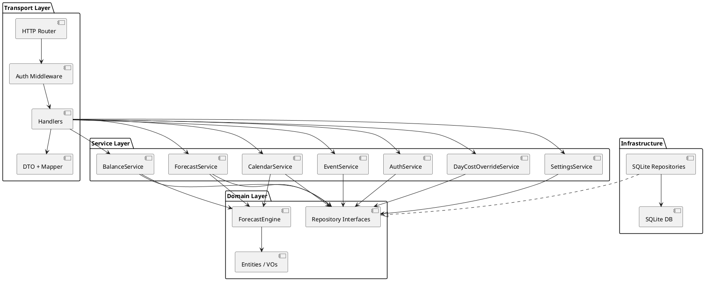
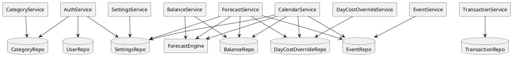

# 4. Backend Architecture

## 4.1 Слои и зависимости

```
┌──────────────────────────────────────────────────────────────┐
│                    cmd/server/main.go                        │
│                   (Composition Root / DI)                    │
└────────────────────────────┬─────────────────────────────────┘
                             │ wires
┌────────────────────────────▼─────────────────────────────────┐
│              internal/transport/http                         │
│  handlers │ middleware │ dto │ mapper                        │
│  depends on: service                                         │
└────────────────────────────┬─────────────────────────────────┘
                             │
┌────────────────────────────▼─────────────────────────────────┐
│              internal/service                                │
│  AuthService │ EventService │ ForecastService │ ...          │
│  depends on: domain (entities + interfaces + forecast engine)│
└──────────────┬───────────────────────────────┬───────────────┘
               │                               │
┌──────────────▼──────────────┐  ┌─────────────▼───────────────┐
│   internal/domain           │  │ internal/repository/sqlite  │
│   entities, VOs, forecast   │  │ implements domain interfaces│
│   repository interfaces     │◄─┤                             │
│   (NO external deps)          │  │ depends on: domain          │
└─────────────────────────────┘  └─────────────────────────────┘
```

### Правило зависимостей

| Слой | Может зависеть от | Не может зависеть от |
|------|-------------------|---------------------|
| `domain` | stdlib only | service, transport, repository |
| `service` | domain | transport, repository concrete types |
| `repository` | domain, database driver | transport, service |
| `transport` | service, domain (для маппинга) | repository |

**Почему интерфейсы в domain, а не в service:** классический Clean Architecture — domain определяет контракт persistence; repository реализует.

**Альтернатива:** интерфейсы рядом с потребителем (Go idiom «accept interfaces») — допустимо, но для нескольких repositories централизация в domain нагляднее.

## 4.2 Структура каталогов backend

```
backend/
├── cmd/
│   ├── server/main.go
│   └── migrate/main.go
├── internal/
│   ├── domain/
│   │   ├── user.go
│   │   ├── settings.go
│   │   ├── balance.go
│   │   ├── event.go
│   │   ├── category.go
│   │   ├── transaction.go
│   │   ├── day_cost_override.go
│   │   ├── money.go
│   │   ├── date.go
│   │   ├── recurrence.go
│   │   ├── forecast/
│   │   │   ├── engine.go          # ForecastEngine — чистая функция
│   │   │   ├── expand.go          # ExpandEvents
│   │   │   ├── horizon.go         # ResolveHorizon
│   │   │   └── engine_test.go
│   │   └── repository/            # ИНТЕРФЕЙСЫ
│   │       ├── user_repository.go
│   │       ├── settings_repository.go
│   │       ├── balance_repository.go
│   │       ├── event_repository.go
│   │       ├── category_repository.go
│   │       ├── transaction_repository.go
│   │       └── day_cost_override_repository.go
│   ├── service/
│   │   ├── auth_service.go
│   │   ├── settings_service.go
│   │   ├── balance_service.go
│   │   ├── event_service.go
│   │   ├── category_service.go
│   │   ├── transaction_service.go
│   │   ├── day_cost_override_service.go
│   │   ├── calendar_service.go    # оркестрация ForecastEngine
│   │   └── forecast_service.go
│   ├── repository/
│   │   └── sqlite/
│   │       ├── db.go
│   │       ├── user_repo.go       # РЕАЛИЗАЦИИ
│   │       ├── settings_repo.go
│   │       ├── balance_repo.go
│   │       ├── event_repo.go
│   │       ├── category_repo.go
│   │       ├── transaction_repo.go
│   │       └── day_cost_override_repo.go
│   └── transport/
│       └── http/
│           ├── server.go
│           ├── router.go
│           ├── middleware/
│           │   ├── auth.go
│           │   ├── logging.go
│           │   └── recovery.go
│           ├── handler/
│           │   ├── auth_handler.go
│           │   ├── settings_handler.go
│           │   ├── balance_handler.go
│           │   ├── event_handler.go
│           │   ├── category_handler.go
│           │   ├── transaction_handler.go
│           │   ├── day_cost_override_handler.go
│           │   ├── calendar_handler.go
│           │   └── forecast_handler.go
│           ├── dto/
│           │   ├── auth.go
│           │   ├── settings.go
│           │   ├── balance.go
│           │   ├── event.go
│           │   ├── category.go
│           │   ├── transaction.go
│           │   ├── day_cost_override.go
│           │   ├── calendar.go
│           │   └── forecast.go
│           └── mapper/
│               ├── event_mapper.go
│               ├── money_mapper.go
│               └── ...
├── migrations/
└── go.mod
```

## 4.3 Интерфейсы репозиториев (domain/repository)

```go
// domain/repository/event_repository.go
package repository

type EventRepository interface {
    Create(ctx context.Context, event domain.FinancialEvent) error
    Update(ctx context.Context, event domain.FinancialEvent) error
    Delete(ctx context.Context, userID, eventID uuid.UUID) error
    GetByID(ctx context.Context, userID, eventID uuid.UUID) (domain.FinancialEvent, error)
    ListByUser(ctx context.Context, userID uuid.UUID) ([]domain.FinancialEvent, error)
}
```

```go
// domain/repository/balance_repository.go
type BalanceRepository interface {
    CreateAnchor(ctx context.Context, anchor domain.BalanceAnchor) error
    GetLatestAnchor(ctx context.Context, userID uuid.UUID) (domain.BalanceAnchor, error)
    ListAnchors(ctx context.Context, userID uuid.UUID) ([]domain.BalanceAnchor, error)
}
```

Аналогично: `UserRepository`, `SettingsRepository`, `CategoryRepository`, `TransactionRepository`, `DayCostOverrideRepository`.

## 4.4 Service Layer (use cases)

### AuthService

- `Login(login) → (user, token)` — find-or-create user, seed defaults
- Генерирует простой session token (UUID), хранит in-memory или SQLite sessions table

### BalanceService

- `SetAnchor(userID, amount, anchoredAt)` — создаёт новый якорь
- `GetBalanceState(userID)` — latest anchor + ForecastEngine для computed balance

### EventService

- CRUD financial events
- Валидация recurrence rules
- MVP: update/delete всей серии

### CalendarService

- `GetCalendar(userID, from, to)` — загружает все inputs → ForecastEngine → DayProjection[]

### ForecastService

- `GetForecast(userID)` — ForecastEngine → ForecastSummary

### DayCostOverrideService

- CRUD overrides
- Валидация пересечений (warning, не block)

## 4.5 Composition Root (main.go)

```go
func main() {
    db := sqlite.Open(os.Getenv("DATABASE_PATH"))
    
    // Repositories (implementations)
    userRepo := sqlite.NewUserRepository(db)
    eventRepo := sqlite.NewEventRepository(db)
    // ...

    // Services
    authSvc := service.NewAuthService(userRepo, settingsRepo, categoryRepo)
    eventSvc := service.NewEventService(eventRepo)
    calendarSvc := service.NewCalendarService(
        balanceRepo, settingsRepo, eventRepo, dayCostOverrideRepo,
    )
    // ...

    // HTTP
    handler := httphandler.NewRouter(authSvc, eventSvc, calendarSvc, ...)
    http.ListenAndServe(":8080", handler)
}
```

**Почему ручной DI:** для MVP проще и прозрачнее wire/fx; при росте можно добавить `google/wire`.

## 4.6 Диаграмма компонентов (PlantUML)



## 4.7 Диаграмма зависимостей сервисов (PlantUML)



## 4.8 Middleware

### Auth Middleware

```
Request → extract X-User-ID or Authorization token → load user → context.WithValue(userID)
```

**MVP:** token = user_id (или session table). **v2:** JWT.

**Почему middleware, а не per-handler check:** DRY; замена auth strategy в одном месте.

## 4.9 Error Handling

```go
// domain/errors.go
var (
    ErrNotFound     = errors.New("not found")
    ErrValidation   = errors.New("validation")
    ErrConflict     = errors.New("conflict")
)
```

Transport маппит:
- `ErrNotFound` → 404
- `ErrValidation` → 422
- `ErrConflict` → 409
- default → 500

## 4.10 Тестирование

| Уровень | Что тестируем | Где |
|---------|---------------|-----|
| Unit | ForecastEngine, ExpandEvents, ResolveHorizon | `domain/forecast/*_test.go` |
| Unit | Service validation | `service/*_test.go` с mock repos |
| Integration | SQLite repos | `repository/sqlite/*_test.go` |
| HTTP | Handlers end-to-end | `transport/http/handler/*_test.go` |

**Почему ForecastEngine в domain:** 80% бизнес-ценности; тесты без БД, быстрые, детерминированные.

## 4.11 Расширяемость

| Изменение | Действие |
|-----------|----------|
| GraphQL | `transport/graphql/` + resolvers → те же services |
| PostgreSQL | `repository/postgres/` implements same interfaces |
| Background jobs | `cmd/worker/` + shared services |
| Auth upgrade | Replace middleware, add sessions/JWT table |
